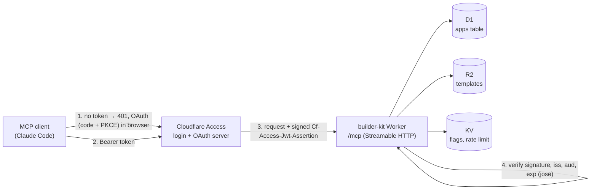

# cloudflare-preparation

A small, real **remote MCP server on Cloudflare Workers** (`builder-kit`), plus a refresher on CI/CD and web security fundamentals.

> **Status:** deployed and in use from Claude Code. Signed-in users only (Cloudflare Access), tested in CI and deployed automatically on every merge to `main`.

## What it is

`builder-kit` is an MCP server that AI coding tools (Claude Code, Cursor) connect to over HTTP. It gives non-developer "builders" approved app templates and a registry of the apps they have shipped. Every user signs in through Cloudflare Access and only ever sees and changes their own apps.

## Architecture



1. The first request has no token. Access answers `401` and points the client to its OAuth metadata. The client registers itself and the user signs in in the browser (authorization code + PKCE).
2. After that, the client sends a bearer token on every request.
3. Access checks the token and its policy, then forwards the request with a JWT it signed.
4. The Worker verifies that JWT itself (signature against Access's public keys, issuer, audience, expiry) and takes the user's identity from it. Anything else gets `401`.

## Tools

| Tool | What it does | Storage |
|---|---|---|
| `ping` | Health check: data center and time | none |
| `list_templates`, `get_template` | Approved app templates as Markdown | **R2** |
| `register_app` | Add an app to your registry (http/https URLs only) | **D1**, flag and rate limit in **KV** |
| `list_my_apps` | Your apps, newest first | **D1** |
| `delete_app` | Delete one of **your** apps by id | **D1** |

## Run locally

```bash
cd builder-kit
npm ci
npx wrangler d1 migrations apply builder-kit --local
npm test          # integration tests in workerd (local D1/R2/KV)
npm run dev       # http://localhost:8787/mcp
```

Locally there is no Access in front of the Worker, so real requests get `401`. The tests play Access's role: they sign their own JWTs and serve the matching public key.

## CI/CD

`.github/workflows/ci.yml` (GitHub Actions):

- **Every pull request and push:** `npm ci` → type-check → lint → tests. `main` is protected: a PR can't be merged unless this `check` job is green.
- **Push to `main`:** after `check` passes, the `deploy` job applies D1 migrations (`--remote`), then runs `wrangler deploy`. It runs in the GitHub environment `production`, the only place the Cloudflare credentials can be read.

## Security notes

- **Authentication:** Cloudflare Access with Managed OAuth. The Worker also verifies the Access JWT itself (defense in depth), and fails closed.
- **Authorization:** every query is scoped by the owner from the verified token (`WHERE id = ? AND owner = ?`). A test proves one user can't delete another user's app (IDOR), and "not yours" looks the same as "doesn't exist".
- **Input:** zod schemas on every tool. SQL only through prepared statements. Template names match an allowlist regex (no path tricks). App URLs are stored, never fetched (no SSRF), and `javascript:` URLs are rejected.
- **Secrets:** none in the repo. The Access team domain and audience tag are public identifiers, so they are plain `vars`. CI uses a Cloudflare API token limited to Workers Scripts + D1 Edit, stored as a GitHub environment secret. The workflow's own `GITHUB_TOKEN` is read-only.
- **Feature flag:** registration can be switched off in KV without a deploy, and missing or unexpected values mean "closed".

## What I'd do next for production

- **Audit log table:** who called which tool, on what, and when.
- **Rate limiting with a Durable Object** (or the Rate Limiting binding). The KV counter is eventually consistent and not atomic, so it's only a demo.
- **A staging environment** with its own D1, deployed on PRs, plus gradual deployments (`wrangler versions deploy`) for production.
- **Alerts** on spikes in 401s and errors.
- Use the JWT `sub` claim as the owner key instead of the email, which can change.
- Expand/contract migrations, so a code rollback never breaks on the schema.

## What I learned coming from stdio MCP servers

- **The protocol is the same, the hard parts aren't.** The tool code looked like my stdio servers. What was new was everything around it: one URL serving many users, so identity, per-user data and authorization suddenly matter.
- **Authentication isn't authorization.** Getting Access to log users in was half the job. Every query still has to check *whose* data it touches.
- **Stateless means state lives somewhere else.** Nothing survives in memory between requests. I had to pick the right store: D1 for queryable data, R2 for files, KV for read-heavy config, and know why KV is wrong for an exact counter.
- **Test in the real runtime.** The tests run in workerd with real local D1, R2 and KV, not mocks. I learned that storage isn't reset between tests the hard way, when a test failed on another test's data.
- **CI/CD for a Worker is small.** Two jobs, a scoped token and branch protection gave me automatic, checked deploys.

## Ground rules

- Written with Claude Code, but every file must be explainable by me.
- Nothing is claimed until it is deployed and works from Claude Code.
- No secrets in the repo: `.dev.vars` stays in `.gitignore`.

The full plan is in [#1](https://github.com/chillyweather/cloudflare-preparation/issues/1). Each stage was one issue (#2–#7).
